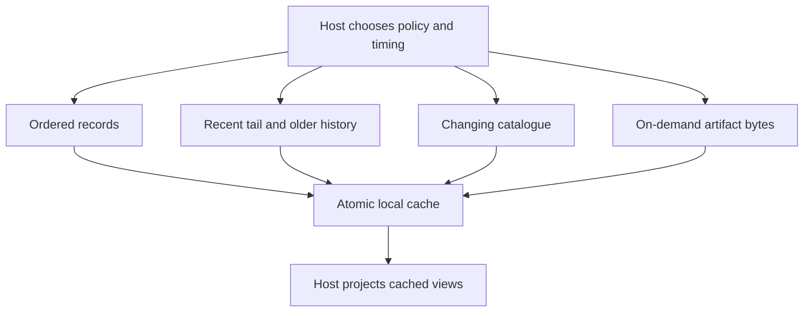

# Read locally, then catch up deliberately

Imagine a desktop transcript with 100 committed messages. A phone cached through message 90 can show those messages while disconnected. When connected, its host captures head 100, applies bounded pages through 100, then checks again for newer work. A wake notification is only a reason to check; losing it must not lose data.

This Rust library supplies validation, coordination and reference adapters. It does not start background jobs or own application meaning, authorization policy, pairing, scheduling or agent commands. Its seven record/catalogue labs and artifact transfer are implemented; the crate is unpublished and production Nessa integration remains future work.

| What you need | Read next |
| --- | --- |
| Copy messages without losing progress | [Record pass](records.md), [identity and permission](identity.md) |
| Open a long transcript quickly | [History](history.md) |
| Keep a changing conversation/task list current | [Catalogue pass](catalogue.md), [saved progress](progress.md) |
| Download a file safely | [Artifact state](artifacts.md), [transfer](transfer.md) |
| Recover a lost reply or reset | [Recovery decisions](recovery.md) |
| Compose storage, networking and UI | [Adapters](adapters.md), [network](network.md), [host examples](host.md) |
| Bound allocations and find owners | [Bounds](bounds.md), [feature inventory](inventory.md) |
| Evaluate current evidence | [Verification](verification.md) |

A cached view being readable is different from its source being current. An unchanged pass can avoid record payload transfer while still using head, authorization and protocol bytes. No lab result here establishes encrypted remote transport, mobile background operation, failover or device power-loss durability.
