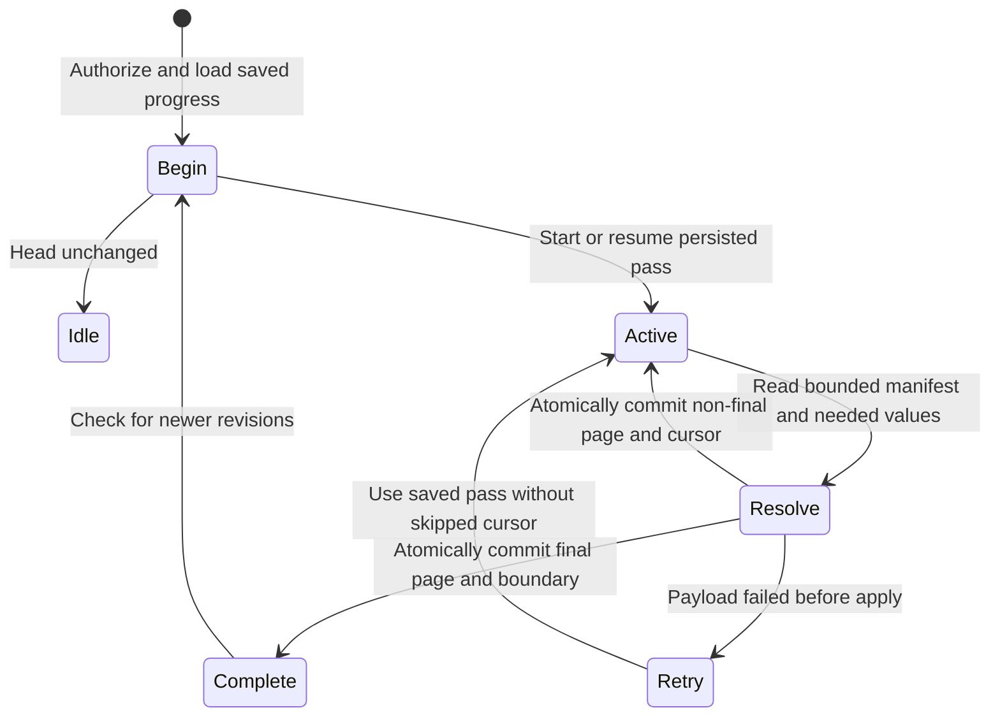

# Refresh a changing conversation or task list

A catalogue stores each entry's current value, not every historical edit. Begin at completed revision 10 and capture boundary 20. Manifest pages traverse stable creation keys; an entry updated during the scan can resolve to a newer authorized value. The current pass still completes boundary 20, and a later pass discovers subsequent changes. This is not a frozen full-list snapshot.

## A failed page does not complete the list

Cached revisions at least as new as manifest entries avoid repeated payload reads. Needed entries resolve under current authorization; the source may return a newer value or retained deletion marker. If any value read or validation fails, no page plan is applied. Keep the saved pass and cached view; show stale/error rather than an empty list. An uncertain store commit instead requires reloading progress.

Only the final page advances completed revision to the captured boundary and clears active progress. Non-final pages retain the earlier completed revision and save a continuation. The store compares the current pass/generation inside the transaction. Retained deletion markers prevent old live values from returning; they are not equivalent to physically erasing all source history.

CataloguePage models two pages, fetched values, a saved cursor and final completion. Controls commit before payload resolution and mark the boundary complete on the first page. It omits creation-key ordering, concurrent source churn, authorization and content validation; those are source/test contracts, not proved by this model.
