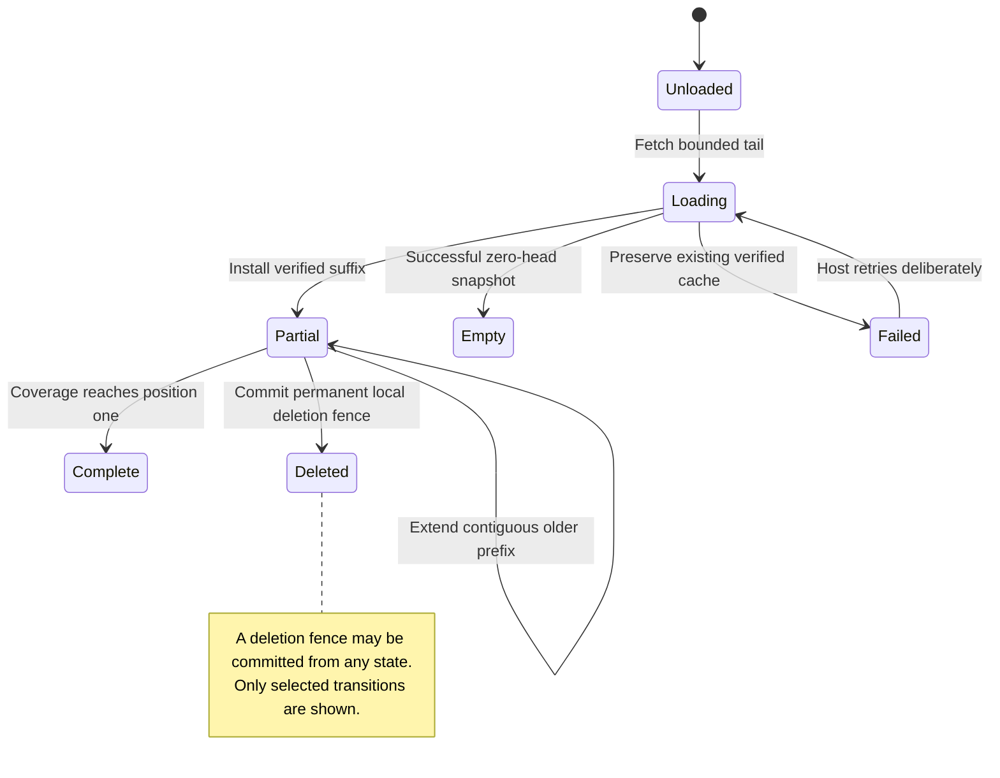

# Open recent messages and load older ones

For a 100-message transcript, a tail can install messages 91–100 with live head 100 and lower bound 91. Loading 81–90 extends older coverage to 81 without rewinding live head. A live append can advance the head while older browsing continues.

## Delayed content cannot undo deletion

Fetching and installation are separate. The host can discard a delayed plan. SQLite tail installation rejects a saved deletion, mismatching scope, non-new generation or a watermark behind saved live head. Older installation requires the current generation, contiguous coverage and identical overlapping IDs/bytes. A permanent local deletion fence removes records and rejects later installations for that retained target. It is not a remote delete command.

`HistoryReadState` distinguishes Unloaded, Loading with optional cache, Partial, CompleteEmpty, Complete, Failed, Stale and Deleted. Source failure is never proof of an empty transcript. If the source pruned older records, expose reset-required/partial status; do not claim coverage down to one.

`HydrationQueue` combines multiple views by choosing the minimum uncovered requested position. Requests still occupy bounded waiter slots including duplicates; it is not an unbounded deduplicating subscription service. Resolve waiters only against saved lower coverage. The host can schedule urgent head work on another source handle between bounded older pages.

HistoryFence explores one fetched older plan, a generation change and a deletion before installation. Independent accepted-generation/deletion facts expose stale or resurrecting installs. It omits tail ordering, overlap bytes and gap validation; Rust tests cover those separately.
