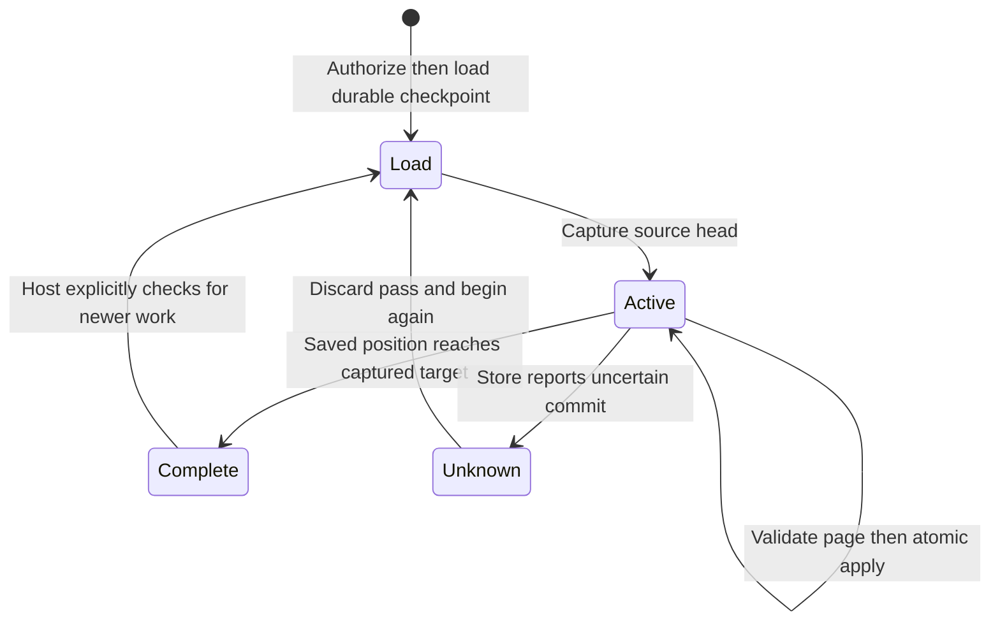

# Catch up through one fixed head

If saved progress is 90 and the authorized source head is 100, `begin_pass` captures 100. A first page can move progress to 95, a second to 100. Source writes to 101 do not move this pass's finish line; call `begin_pass` again afterward. Receivers have independent checkpoints.

## Unknown does not mean unchanged

`step` advances its in-memory position only after store success. A lost commit response can leave the store ahead of that object. Discard it and call `begin_pass` to load progress before retrying; do not force the old checkpoint or blindly replay effects. `Stale` identifies a competing writer; reload too. A confirmed `Failed` has no committed effect under the record-store contract.

Pure `validate_page` checks exact echoed request, scope/start, positive bounded contiguous positions, unique record IDs in the page and decoded byte limits. A page cannot be empty before its target. For a new forward commit, the store must still compare the expected checkpoint and enforce cross-page immutable identity reuse in its transaction. The SQLite reference adapter also accepts an exact already-saved slice as an idempotent no-op; a conflicting or unmatched stale plan is refused. A valid plan alone is not persistence evidence.

Current access is checked before head and each non-complete page read. This is a point-in-time host decision, not a distributed revocation fence over remote side effects. No timer or retry loop is created by the library; `finish_pass` only drives the captured finite target.

The RecordCommit model has two record positions and independent stored/checkpoint/local counters. New forward atomic apply and a lost response expose the reload rule. Exact already-saved no-op replay is omitted from this model. Controls split checkpoint from data and retry a stale expected position. It abstracts payload validation, storage atomicity, authorization and actual network failure; it does not prove SQLite implementation correctness or liveness.
