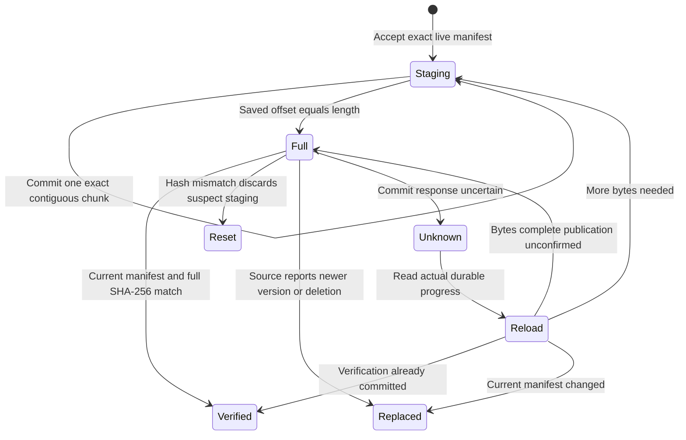

# Download, verify and publish bytes

A 150 KiB file takes bounded chunks of at most 64 KiB. Each append saves exact bytes and the next offset together. After the final chunk, the offset equals length but the cache is still staging. Call `publish_if_current` to recheck the authorized manifest and ask the store to verify/publish.

## Full length is not verified content

`transfer_one` returns after at most one chunk, leaving scheduling to the host. Exact request echo and length are validated. Repeating identical committed chunk bytes is idempotent; conflicting bytes or an offset race are refused. On `Uncertain`, reload progress instead of assuming the write failed.

`publish_if_current` queries the source again. A changed version or deletion is installed before returning VersionChanged/Deleted. Failure to obtain that current source answer cannot publish old staging. The store independently checks exact saved manifest, revocation/fence and complete contiguous length/hash in its transaction. HashMismatch clears suspect chunks and resets offset; reread before restarting.

Source recheck and local commit are separate operations. A remote update immediately afterward is possible; this is a checked version at a point in time, not a global lock preventing future changes. Host refresh and access policy remain necessary.

ArtifactPublish explores two chunks, independent hash validity and a changing local manifest. Publication records offset/hash/version evidence. Controls publish early, ignore hash or accept the wrong current version. The model does not compute SHA-256, simulate SQLite, prove remote authority freshness or cover arbitrary files.
